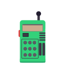

  

# Ohmwork

**Offline amateur radio exam practice for U.S. license exams.**

This is a vibe-coded application with the purpose of providing an offline way for U.S. amateur radio operators to study for their license.

## Features

- All questions from the Technician, General, and Amateur Extra pools
- Practice tests with an optional timer
- A work-in-progress stats page for tracking your progress

## About this project

This program is frankly very simple, and I could have coded it myself, but I can guarantee it would have turned out worse. The program’s icon and this README are my own work.
